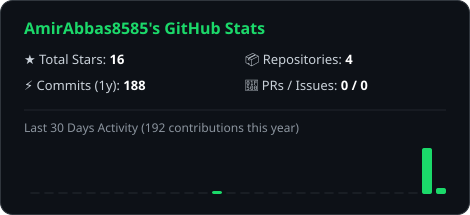
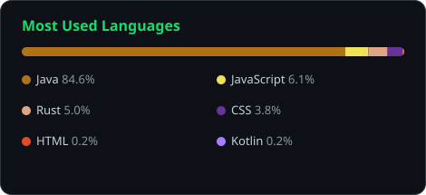

<h1 align="center">Hi, I'm Amir Abbas 👋</h1>

  

  
  

---

### 🧰 Tech Stack

  
  
  
  
  
  

---

### 🚀 Featured Projects

<table>
  <tr>
    <td width="50%" valign="top">
      <h4>🛡️ Jester Anti Cheat</h4>
      

        A packet-based anti-cheat for <b>Paper / Spigot / Purpur / Folia</b>, built on the Grim prediction engine with <b>40+ extra checks</b> (combat, scaffold, auto-tools) and a strong focus on <b>low false-positives</b> across mixed client versions and proxies.
      

      

        
        
      

    </td>
    <td width="50%" valign="top">
      <h4>⚔️ Black Asta — BetterDiscord</h4>
      

        A <b>Black Clover (Anti-Magic)</b> BetterDiscord theme &amp; companion plugin featuring liquid-glass panels, glowing status auras, floating embers, 6 live palettes, <code>Ctrl + Scroll</code> zoom, and auto-updates.
      

      

        
        
      

    </td>
  </tr>
</table>

---

### 💬 Catch me on Discord — live status

  

---

### 📊 GitHub Analytics

  
  

#### 🐍 Watch my contributions get eaten

  

---

  🎮 <b>Community Discord:</b> <a href="https://discord.gg/PfDDFKMaMs">discord.gg/PfDDFKMaMs</a>
  &nbsp;·&nbsp; <b>DM:</b> <a href="https://discord.com/users/1062758325508382770">amirabbas2556</a>

